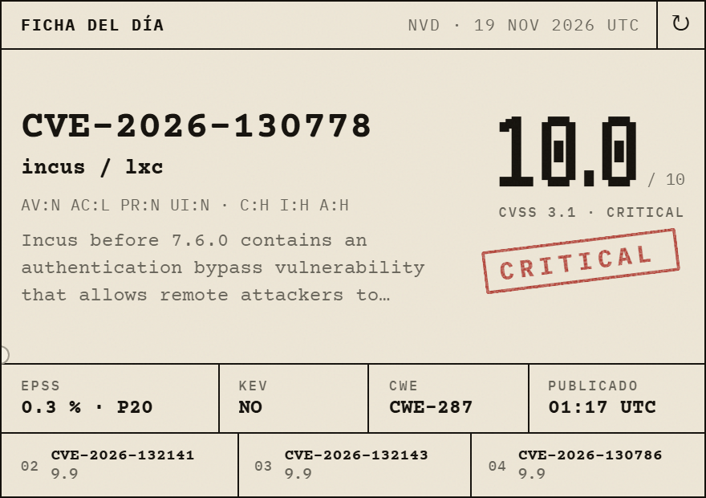
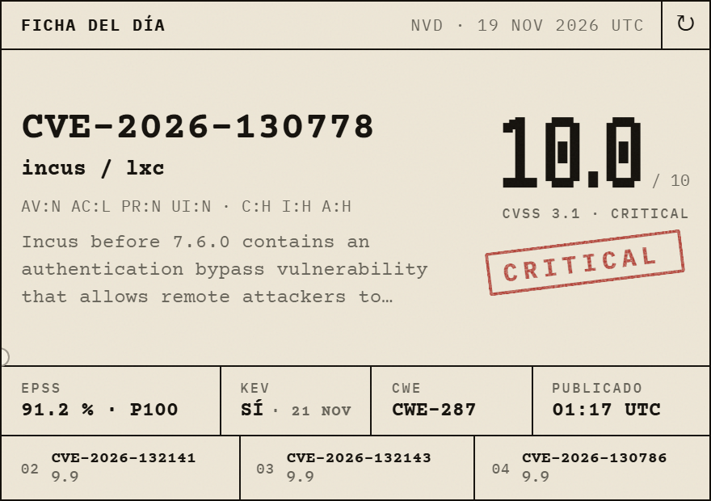
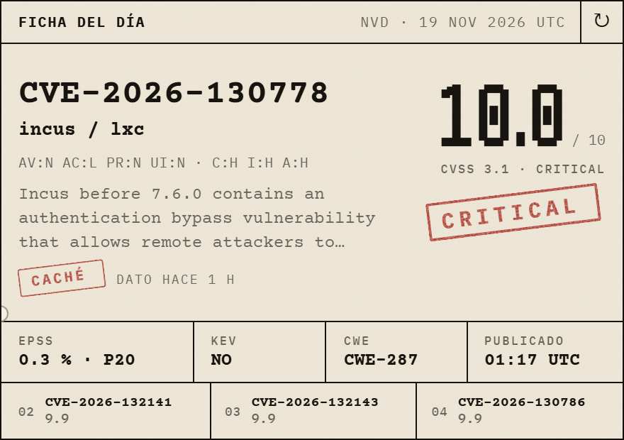

# Ficha del día

Widget de escritorio *always-on* que responde una sola pregunta: **cuál es el CVE más crítico publicado hoy**. Una ficha de archivo en papel, tinta y dot-matrix — sin dashboard, sin nube, sin cuenta.

[](https://github.com/gam04/my-cve/actions/workflows/ci.yml)
[](LICENSE)



## Qué hace

- Muestra **un** CVE: el de mayor CVSS del día UTC, con score, severidad, vector, EPSS, KEV (y fecha límite cuando aplica), CWE y producto afectado.
- Los tres siguientes quedan en una tira de microficha, para contexto.
- Refresca al arrancar, cada 30 minutos y a pedido (además al cambiar el día UTC y al reanudar tras suspensión).
- Sin red, sigue mostrando el último tablero válido con un sello `CACHÉ` y su antigüedad.
- Vive en la bandeja: mostrar/ocultar, refrescar, copiar ID, abrir en NVD, arrancar con el sistema.
- Ventana frameless siempre encima, sin barra de tareas, arrastrable; recuerda su posición.

| Normal | KEV | Sin red (caché) |
|---|---|---|
|  |  |  |

## Privacidad y seguridad

- **Sin telemetría ni analytics.** Tráfico saliente solo a: `services.nvd.nist.gov`, `api.first.org`, `www.cisa.gov`.
- `NVD_API_KEY` se lee **solo** de la variable de entorno homónima (nunca se guarda en ajustes, caché ni logs).
- CSP sin `unsafe-inline`/`unsafe-eval`; sin `innerHTML` con datos remotos; enlaces externos abiertos con el opener del sistema.
- Fuentes tipográficas autoalojadas (OFL).

Ver [SECURITY.md](SECURITY.md) para el reporte de vulnerabilidades.

## Instalación

Descargá el instalador de la última versión desde [Releases](https://github.com/gam04/my-cve/releases): **NSIS** (`.exe`) o **MSI** (`.msi`).

- **Requisito:** Windows con [WebView2 Runtime](https://developer.microsoft.com/microsoft-edge/webview2/) (preinstalado en Windows 11 y en la mayoría de Windows 10).
- **SmartScreen:** los binarios no están firmados con certificado de código; Windows puede advertir en la primera ejecución. Elegí *Más información* → *Ejecutar de todos modos*.

## Desarrollo

Requisitos: **Node.js ≥ 20**, **pnpm 11** (ver `packageManager`), **Rust estable** (toolchain en `rust-toolchain.toml`), WebView2.

```bash
pnpm install
pnpm app:dev       # Tauri + Vite en caliente
```

> **Nota Windows (PATH):** si `cargo` no se encuentra, agregá `%USERPROFILE%\.cargo\bin` al PATH del usuario y reabrí la terminal. Ejemplo en PowerShell:
> ```powershell
> $cargo = Join-Path $env:USERPROFILE ".cargo\bin"
> $cur = [Environment]::GetEnvironmentVariable("Path","User")
> if ($cur -notlike "*$cargo*") { [Environment]::SetEnvironmentVariable("Path", ($cur.TrimEnd(';') + ";" + $cargo), "User") }
> ```

Comprobaciones (las que corre CI):

```bash
pnpm check                  # svelte-check
pnpm test                   # vitest
pnpm build                  # vite (dist/)
cargo fmt --check --manifest-path src-tauri/Cargo.toml
cargo clippy --manifest-path src-tauri/Cargo.toml --all-targets -- -D warnings
cargo test --manifest-path src-tauri/Cargo.toml
```

Auditoría visual de layout (las 6 fixtures, sin recortes/solapes):

```bash
pnpm build
pnpm exec vite preview --port 1420 --strictPort
# en otra terminal:
node scripts/audit.mjs
node scripts/shot.mjs   # regenera shots/ (ignorado por git)
```

### Construir instaladores

```bash
pnpm tauri build
# artefactos en src-tauri/target/release/bundle/ (nsis/ y msi/)
```

## Stack

| Capa | Elección | Por qué |
|---|---|---|
| Shell | Tauri v2 (Rust) | Binario y RAM en orden de magnitud menor que Electron |
| Datos | Rust + `tauri-plugin-http` | Sin CORS, sin proxy, caché en disco y clave fuera del WebView |
| UI | Svelte 5 + TypeScript + Vite | DOM plano, sin VDOM, ideal para una tarjeta única |
| Fuentes | Courier Prime, IBM Plex Mono, Handjet | Autoalojadas (OFL), sin CDN |

## Fuentes de datos

- [NVD 2.0](https://services.nvd.nist.gov/rest/json/cves/2.0) — vulnerabilidades y CVSS
- [FIRST EPSS](https://api.first.org/data/v1/epss) — probabilidad de explotación
- [CISA KEV](https://www.cisa.gov/sites/default/files/feeds/known_exploited_vulnerabilities.json) — explotación conocida

## Contribuir

Ver [CONTRIBUTING.md](CONTRIBUTING.md). Los cambios se validan con el workflow de [CI](.github/workflows/ci.yml).

## Licencia

[MIT](LICENSE) © 2026 Gam. Tipografías bajo sus licencias [OFL](https://scripts.sil.org/OFL).
